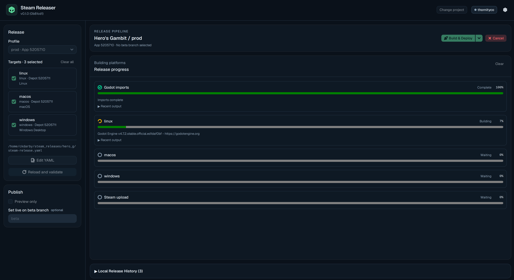

# Steam Releaser
Build and publish Godot, Unity, custom, or prebuilt games to Steam from a desktop
app or CLI.



## Using It: Getting Started

- Download the [latest release](https://github.com/thornity/steam-release-tool/releases)
- Launch application
- Gather from Steam your [appId](https://partner.steamgames.com/doc/store/application) & [depotId](https://partner.steamgames.com/doc/store/application/depots)
- Use AI to generate yaml from [examples](examples/)
- AI provide configuration for [Steamworks app installation](https://partner.steamgames.com/doc/sdk/uploading?l=turkish#Initial_Setup_New_App). Example found [here](docs/general_installation_launch_example.png).

## Development Launch the GUI

For prerequisites, or Windows, see the [desktop guide](docs/desktop.md).

On Linux or macOS, open the GUI with live reload via:

```sh
./gui
```

## AI Disclaimer
This Project heavily utilizes AI for development.

## Documentation & AI References

- [Desktop app](docs/desktop.md): setup, Steam sign-in, releases, and history.
- [CLI](docs/cli.md): quick start, commands, options, and GitHub Actions.
- [Configuration](docs/configuration.md) and [examples](examples).
- [Development](docs/development.md) and [contributing](CONTRIBUTING.md).
- [Architecture](docs/architecture.md), [security](SECURITY.md), and [audit](docs/audit.md).