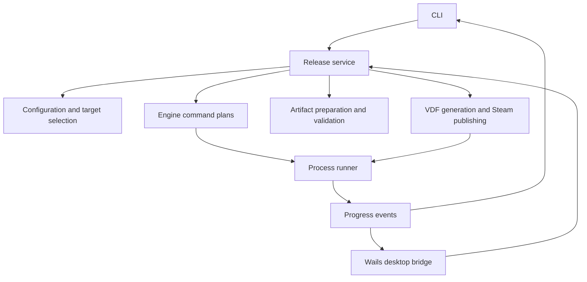

# Steam Releaser architecture

The CLI and desktop app use the same Go service to select targets, build games,
validate artifacts, and publish through SteamCMD. Game engines and SteamCMD are
external programs; this repository contains the release orchestration and an
optional Unity Editor build method.

## Package responsibilities

| Package | Responsibility |
| --- | --- |
| `config` | Strict YAML loading, defaults, profiles, targets, and configuration edits |
| `tools` | Executable discovery and Unity Editor version preference |
| `engine` | Godot, Unity, custom, and prebuilt command plans |
| `release` | Process execution, cancellation, bounded output, and progress events |
| `artifact` | Output directories, confined post-build copies, and artifact checks |
| `steam` | Depot selection, VDF generation, authentication, and SteamCMD publishing |
| `doctor` | Local project, executable, and engine diagnostics |
| `service` | Build, upload, and ship orchestration shared by both entry points |
| `history` | Bounded local release records and retry metadata for the desktop |
| `localstore` | Shared SQLite database, schema, migrations, and desktop preferences |

Machine-local records use `steam-releaser.db` in the Steam Releaser configuration
directory, including Local Release History, the cached Steam username, recent
projects, project-folder overrides, saved selections, and notification settings.
`STEAM_RELEASER_CONFIG_DIR` overrides the directory. SQLite transactions protect
updates across CLI and desktop processes. History keeps one row per attempt,
with indexed configuration/project paths and JSON metadata for retry fidelity;
saving an attempt and trimming to the latest 50 records is atomic. Legacy history
and usernames import once; browser preferences import only missing keys before
the frontend removes the migrated browser values. YAML remains the shared project
configuration.

## Release flow

`plan` resolves configuration and commands without writing scripts or executing
tools. `build` prepares directories, imports Godot when configured, builds the
selected targets, applies copy rules, and validates artifacts. Godot exports can
run concurrently after import when configured paths do not overlap; Unity targets
run serially because its Editor locks the project. Custom commands default to
serial execution. Overlapping build outputs are rejected, and overlapping
content paths serialize target builds and produce a warning.

`upload` validates the selected artifacts, generates depot/app VDF files or uses
an existing VDF, and invokes SteamCMD. Every selected shared depot must include
all of its targets. `ship` checks local upload prerequisites before building,
then follows the upload path. Steam's preview and beta-branch options remain
explicit upload choices. Build, upload, and ship operations on the same project
are mutually exclusive on one machine when their project roots resolve to the
same identity, including across CLI and desktop processes. Windows identifies a
project by its resolved path; different drive mappings to the same directory may
not share a lock. A competing operation fails; `plan` remains read-only.

The desktop records content fingerprints for completed targets and immediately
before upload. Retry checks those fingerprints while holding the project lock:
changed built targets are rebuilt, and changed prebuilt or upload content is
rejected. A missing checkpoint prevents automatic upload retry. Fingerprinting
reads all selected artifacts; it detects changed bytes and paths but does not
establish that the original build used the intended source. Profiles using
`existing_vdf` cannot automatically retry build-and-deploy or upload attempts
because custom scripts may reference other content that the checkpoint cannot
identify. A build-only retry remains available.

The process runner passes an argument array directly to the executable. Custom
commands can explicitly invoke a shell. The desktop supplies authentication
responses through a private pipe and receives process events through Wails.

Target `build.args` and `build.env` configure only that target's build/export
process. Environment overrides inherit the parent process environment and remain
literal; target options do not affect Godot's shared import or SteamCMD. Native
presets and Build Profiles determine exported game features. CLI and desktop
configuration edits patch only the requested option groups, preserving other
settings and YAML comments. Managed native argument overlaps are reported as
warnings without changing existing argument order or behavior.

## Boundaries to preserve

Keep engine-specific command construction out of the frontend. Keep Steam
publishing separate from building so prebuilt artifacts remain supported.
Treat platform and architecture labels as metadata; export presets, Unity Build
Profiles, and custom commands determine the actual executable architecture.

Artifact validation checks existence, file types, contained symlinks, and required
globs. It does not prove freshness, game startup, signing, or compatibility with
a destination platform. The project lock is cooperative: it does not stop other
programs from changing artifacts, cover separate projects with shared output
paths, or guarantee coordination across machines. Path checks use configured
outputs and content roots; custom commands can write elsewhere, path aliases may
not all be detected, and serialized targets can still overwrite shared files.
A future release workspace should give each run isolated staging and a manifest
of verified artifacts. The [audit](audit.md) records the remaining risks.
